<div align="center">

# LearnShare AI · AI 个性化学习资源分享平台

**一个面向大学生的学习资源共享社区 —— 用 AI 把「找资料、读资料、问资料、评资料」的成本降下来**

       

把散落在网盘、群聊和收藏夹里的学习资料，变成**可发现、可理解、可互动、可推荐**的学习资产：
自然语言搜索 · AI 智能摘要 · 混合个性化推荐 · 带「工具调用 + 长期记忆」的 AI 学习助手 · 点赞 / 收藏 / 评分 / 评论 / 关注 / 通知的完整社区闭环。

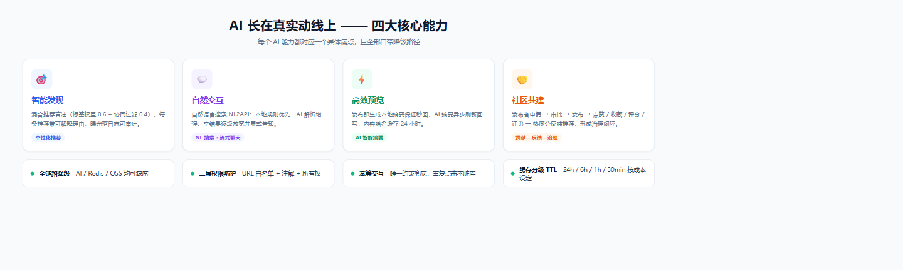

</div>

---

## 📸 页面预览（真实运行截图）

| 首页 · 个性化推荐（带 AI 推荐理由） | AI 对话 · Agent 工具调用 |
|---|---|
| 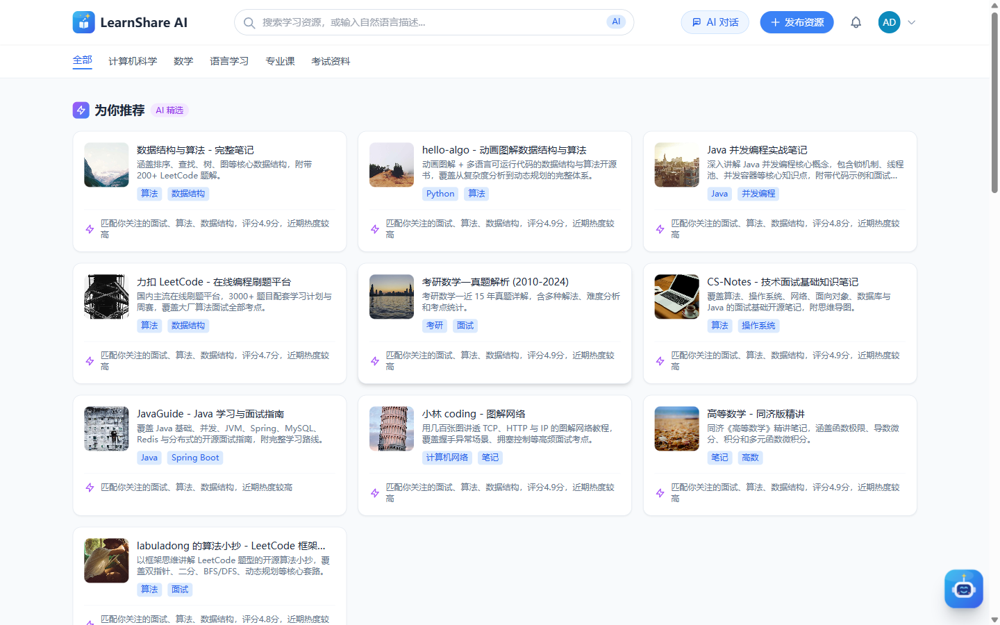 | 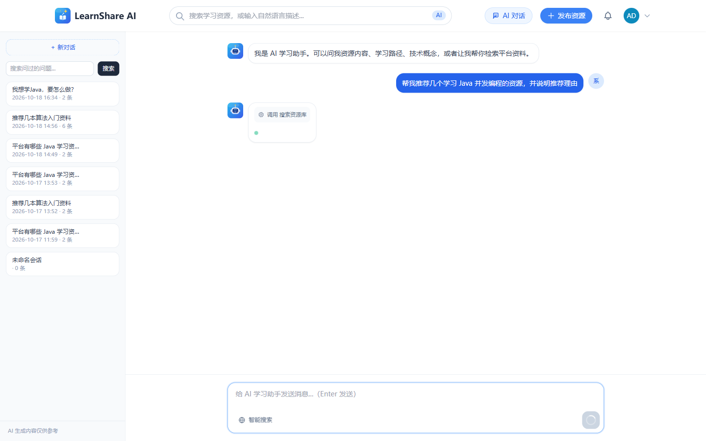 |

| AI 自然语言搜索（意图解析 + 结果） | 资源详情（AI 摘要 + 互动 + 相关推荐） |
|---|---|
| 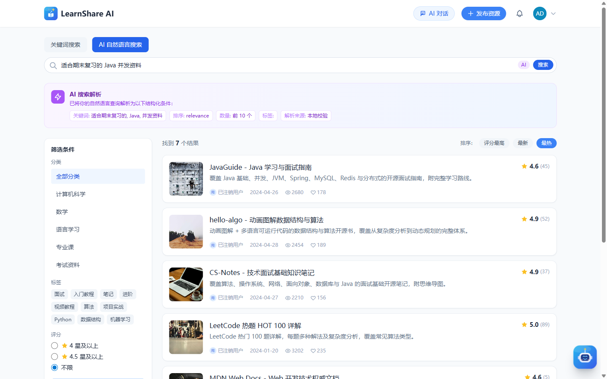 | 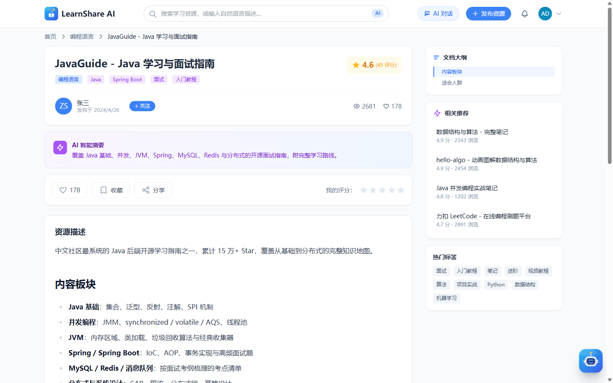 |

| 管理后台仪表盘 | 个人中心 | 通知中心 |
|---|---|---|
| 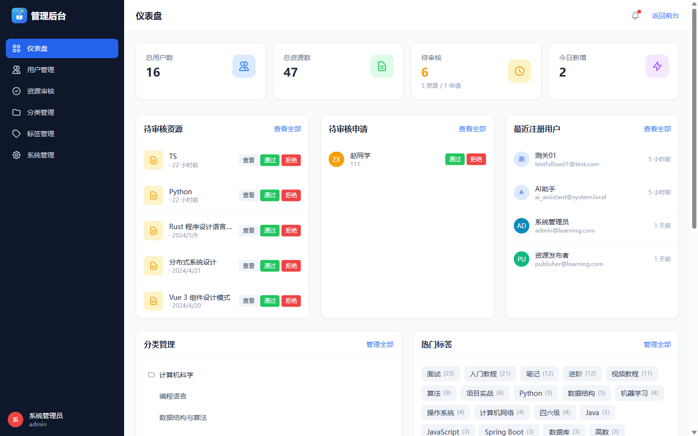 | 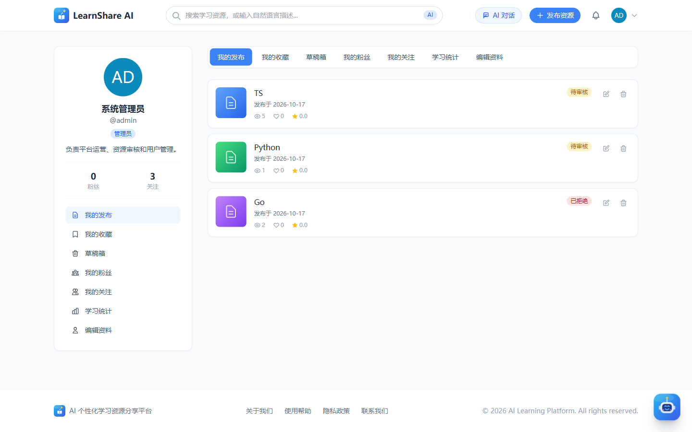 | 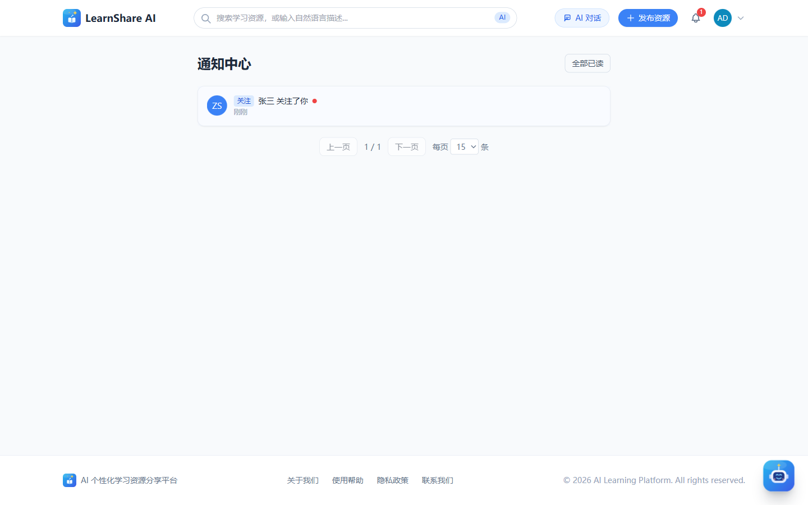 |

<details>
<summary>更多页面：AI 回答渲染 / 评论区 / 发布资源 / 登录</summary>

| AI 对话 · Markdown 渲染回答 | 评论区（多级回复 + @提及） |
|---|---|
| 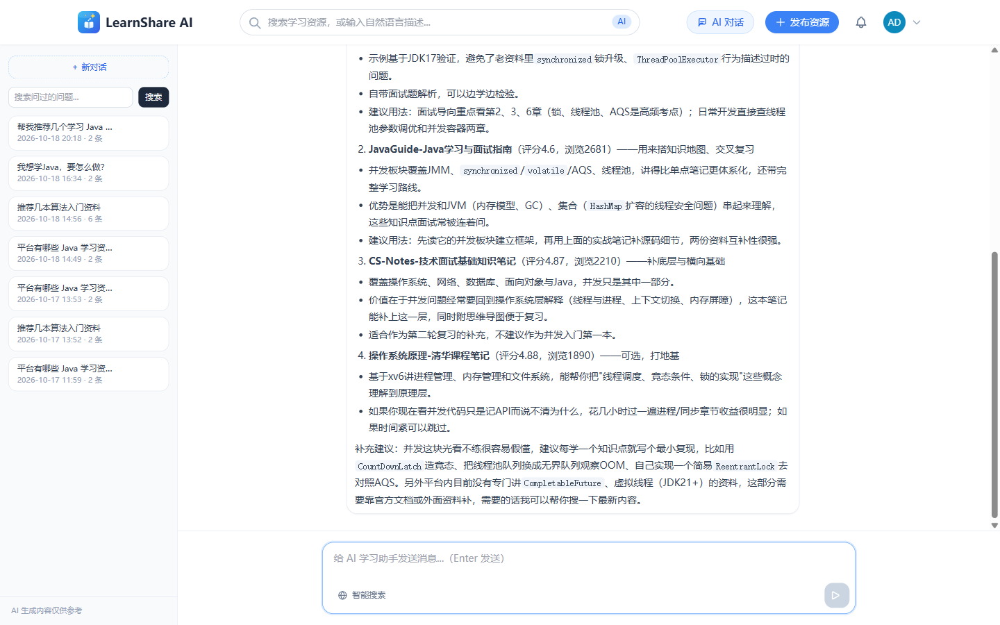 | 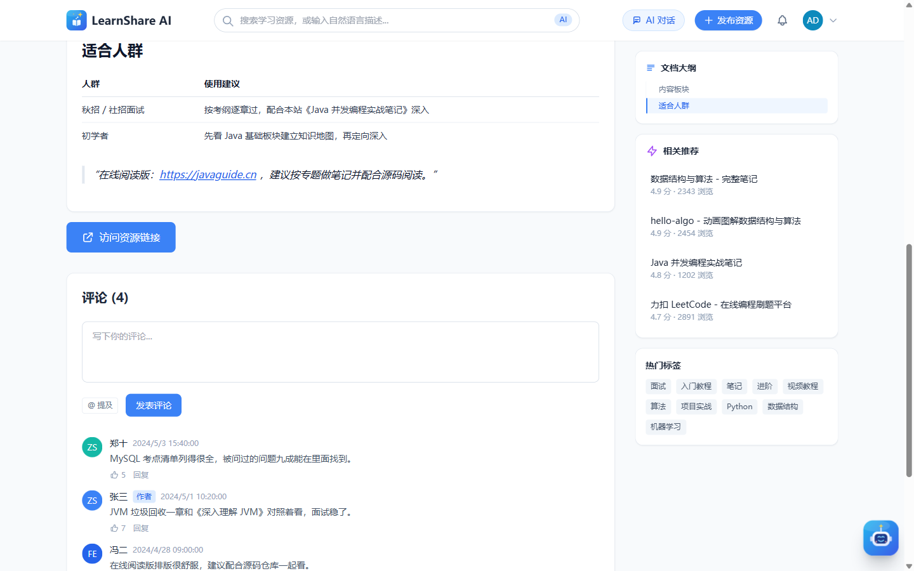 |

| 发布资源（Markdown 编辑器 + 标签） | 登录 |
|---|---|
| 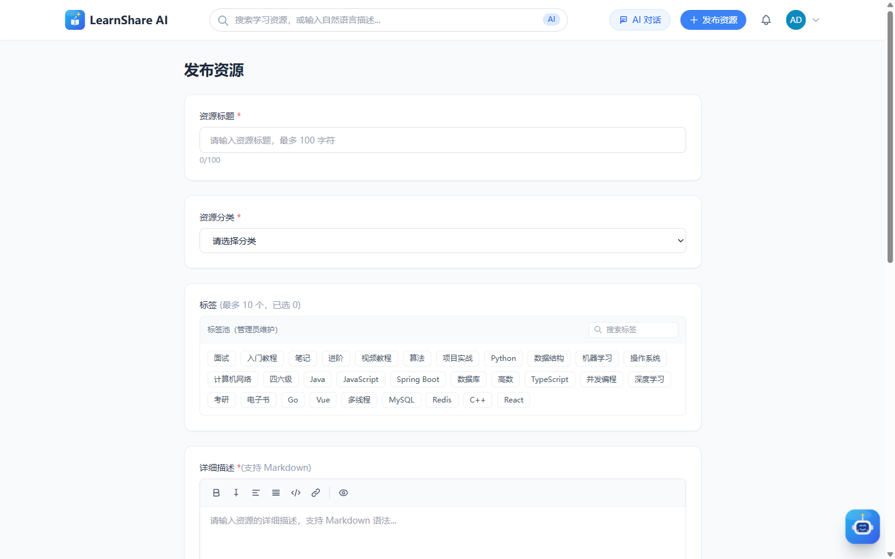 | 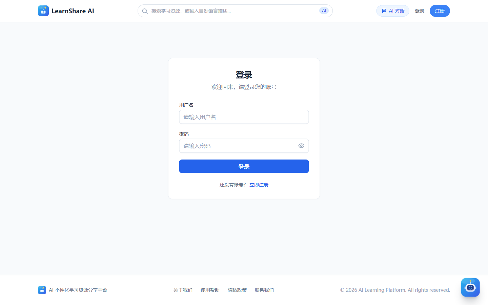 |

</details>

---

## ✨ 核心功能

**AI 能力（全部嵌入真实动线，全部带降级路径）**

- **AI 学习助手（独立对话页）**：基于 LangChain4j 的 Agent 工作流 —— 计划 → 工具调用 → 流式作答。内置三个工具：`search_resources`（站内资源检索）、`get_resource_detail`(资源详情）、`web_search`（Tavily 联网，「智能搜索」开关）；工具调用过程在界面上以气泡实时可见
- **对话持久化 + 长期记忆**：会话与消息落 MySQL（`chat_session` / `chat_message`），刷新不丢；Redis 存储会话记忆，跨轮次理解上下文
- **自然语言搜索**：「适合期末复习的 Java 并发资料」→ AI 解析为结构化意图（关键词 / 分类 / 标签 / 排序 / 数量），本地规则优先、AI 增强、空结果逐级放宽并显式告知
- **AI 智能摘要**：发布即生成本地摘要保证秒回，AI 摘要异步刷新，内容哈希缓存 24h
- **个性化推荐**：混合算法（标签权重 0.6 + 协同过滤 0.4），每条推荐带可解释理由，曝光落日志可审计
- **AI 封面配图**：通义万相文生图 / Pexels 图库 / unDraw 插画三源采集，全部不配则本地插图兜底

**社区与内容**

- 资源发布：文件上传（≤500MB）/ 外部链接、Markdown 描述、草稿箱、四态流转（草稿 → 待审核 → 发布 / 驳回）
- 社区互动：点赞 / 收藏 / 星级评分 / 两级评论（评论可点赞）、**@提及**、**关注与粉丝**、**站内通知**（关注 / 点赞 / 收藏 / 评论 / 回复 / 提及 / AI 摘要 7 类，铃铛未读角标）
- 用户主页：公开主页（`/user/:id`）展示发布 / 收藏 / 粉丝 / 关注
- 内容治理：敏感词过滤 + AI 复审、修订留痕（ContentRevision）、发布者申请审批流
- 管理后台：仪表盘统计、用户管理、资源审核、分类 / 标签 CRUD、系统配置

**工程与安全**

- **全链路降级**：DeepSeek / Tavily / 万相 / Pexels / Redis / OSS 全部「可缺席」—— 无 AI Key 能完整演示发布、搜索、互动；断 Redis 核心链路照常工作
- **三层权限防护**：URL 白名单 → 方法级注解 → 业务层所有权校验；角色热更新（`X-New-Token` 无感续签）
- **幂等交互模型**：点赞 / 收藏 / 评分由数据库唯一约束兜底；JWT_SECRET 启动强校验（缺失 / 过短 / 示例值直接拒绝启动）

---

## 🏗️ 系统架构

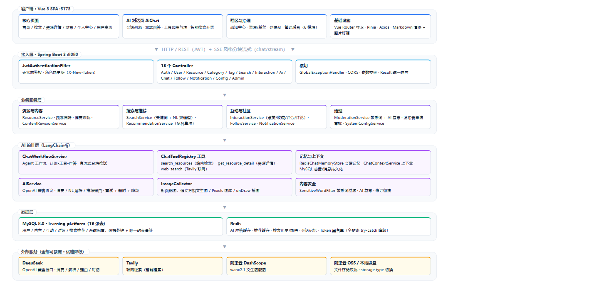

| 层 | 技术与职责 |
|---|---|
| 前端 | Vue 3 + TypeScript + Tailwind CSS + Pinia + Vue Router + Vite，marked + DOMPurify 安全渲染 Markdown |
| 接入层 | Spring Boot 3.2（Java 17），13 个 Controller，JWT 过滤器，统一响应体与全局异常处理 |
| 业务层 | 资源 / 搜索 / 推荐 / 互动 / 关注 / 通知 / 治理等服务，`@Async` 摘要刷新 + `@Scheduled` 热度分 |
| AI 编排层 | LangChain4j 工作流 + 工具注册表 + Redis 记忆 + 会话持久化 + 多源配图 + 内容安全 |
| 数据层 | MySQL 8.0（19 张业务表）+ Redis（缓存 / 记忆 / 历史 / 黑名单，读写全部优雅降级） |
| 外部服务 | DeepSeek（OpenAI 兼容）、Tavily、DashScope 万相、Pexels、阿里云 OSS / 本地磁盘双轨 |

---

## 🗄️ 数据模型

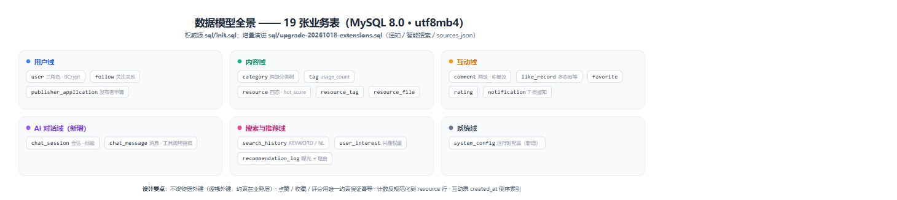

- `sql/init.sql` 为唯一权威源（19 张表）；已有库可直接执行增量脚本 `sql/upgrade-20261018-extensions.sql`（可重复执行，不改动现有数据）
- 不设物理外键（逻辑外键 + 业务层校验）；点赞 / 收藏 / 评分靠唯一约束保证幂等；互动计数反规范化到 `resource` 行，定时任务每小时刷新热度分
- `docs/数据库实体关系图.html` 提供可交互 ER 图（核心 14 表版本，新增表见上图）

---

## 🚀 快速开始

### 环境要求

JDK 17+ · Maven 3.8+ · Node.js 18+ · pnpm · MySQL 8.0+ · Redis 6.0+

### 1. 数据库初始化

```bash
# 首次部署：建库建表 + 种子数据
mysql -u root -p --default-character-set=utf8mb4 < sql/init.sql
mysql -u root -p --default-character-set=utf8mb4 < sql/seed.sql

# 已有旧库：增量升级（通知 / 智能搜索等，可重复执行）
mysql -u root -p --default-character-set=utf8mb4 < sql/upgrade-20261018-extensions.sql
```

### 2. 后端启动

```bash
cd backend

# 复制本地配置模板并填入真实值（application-local.yml 已被 .gitignore 忽略）
cp src/main/resources/application-local.yml.example src/main/resources/application-local.yml

# 编译并运行（默认端口 8080，可用 SERVER_PORT 覆盖）
mvn clean install
mvn spring-boot:run
```

也可以不用配置文件，全部走环境变量：

| 环境变量 | 说明 |
|---|---|
| `DB_PASSWORD` | MySQL 密码 |
| `REDIS_HOST` / `REDIS_PORT` / `REDIS_PASSWORD` | Redis 连接（可缺省，断连自动降级） |
| `JWT_SECRET` | **必填**，至少 32 字节，缺失 / 过短 / 示例值时后端拒绝启动 |
| `AI_API_KEY` | DeepSeek API Key（[申请](https://platform.deepseek.com/api_keys)），未配置时 AI 能力走本地降级 |
| `TAVILY_API_KEY` | Tavily 联网搜索（[免费申请](https://tavily.com)），未配置时「智能搜索」自动降级 |
| `IMAGE_PEXELS_API_KEY` / `IMAGE_WANX_API_KEY`（或 `DASHSCOPE_API_KEY`） | AI 封面配图（可选，三源任缺其一自动跳过） |
| `STORAGE_TYPE` | `local`（默认）/ `oss`（需配 `OSS_ACCESS_KEY_*`） |

后端运行在 `http://localhost:8080`，Swagger 文档：<http://localhost:8080/swagger-ui.html>

### 3. 前端启动

```bash
cd frontend
pnpm install
pnpm run dev
```

前端运行在 `http://localhost:5173`（Vite 已配置 `/api`、`/files` 代理到后端）。

### 4. 登录体验

| 账号 | 密码 | 角色 |
|---|---|---|
| `admin` | `admin123` | 管理员（可进管理后台） |
| `zhangsan` | `123456` | 发布者 |
| `zhaoliu` | `123456` | 普通用户（seed 数据内更多测试账号同密码） |

> 种子账号密码由 `seed.sql` / 升级脚本统一重置，与后端新用户默认密码策略一致。

---

## 📁 项目结构

```
├── backend/                        # Spring Boot 后端
│   └── src/main/java/com/learning/platform/
│       ├── ai/                     # LangChain4j 编排：ChatToolRegistry / 工具 / 配图 / 内容安全
│       ├── config/                 # Security / Redis / MyBatis / CORS / LangChain4j 配置
│       ├── controller/             # 13 个 REST 控制器
│       ├── service/                # 业务服务（含对话工作流 / 记忆 / 通知）
│       ├── security/               # JWT 过滤器
│       └── entity / dto / vo / mapper / common / util
├── frontend/                       # Vue 3 前端
│   └── src/
│       ├── views/                  # 首页 / 搜索 / 详情 / AiChat / 发布 / 个人中心 / 通知 / 管理后台
│       ├── components/             # AiChatWidget（全局悬浮窗）/ 会话列表 / @提及 / 评论树 等
│       └── api / store / router / types / utils
├── sql/                            # init.sql（权威源）+ seed.sql + upgrade-*.sql（增量演进）
├── docs/                           # 交付文档 + 架构图 + 运行截图
├── openspec/                       # 规格化设计（proposal / design / tasks）
└── prototypes/                     # 需求原型 HTML（6 页）
```

## 🔌 API 概览

启动后端后访问 [Swagger 文档](http://localhost:8080/swagger-ui.html) 查看全部接口。常用入口：

| 分类 | 接口 |
|---|---|
| 认证 | `POST /api/v1/auth/login` · `register` · `refresh` |
| 资源 | `GET /api/v1/resources` · `GET /api/v1/resources/{id}` · `POST /api/v1/resources` |
| 搜索 | `GET /api/v1/search`（关键词）· `POST /api/v1/search/nl`（自然语言，返回解析意图） |
| AI | `POST /api/v1/ai/summary` · `GET /api/v1/ai/recommendations` · `POST /api/v1/ai/recommendations/reasons` |
| 对话 | `POST /api/v1/ai/chat/stream`（流式）· `GET /api/v1/chat/sessions`（会话持久化） |
| 社区 | 点赞 / 收藏 / 评分 / 评论 · `POST /api/v1/users/{id}/follow` · `GET /api/v1/notifications` |

## 🧪 测试

- 后端单元 / 集成测试 190 项（`backend/src/test/`，`mvn test`）
- 覆盖：认证权限 / 资源链路 / 搜索推荐 / 互动 / 对话工作流 / 降级与安全 / 管理后台

## 📚 交付文档

| 文档 | 说明 |
|---|---|
| [`docs/PRD.md`](docs/PRD.md) | 产品需求文档 |
| [`docs/需求分析文档.md`](docs/需求分析文档.md) | 需求分析 |
| [`docs/项目架构与核心功能.md`](docs/项目架构与核心功能.md) | 架构设计与核心功能详解 |
| [`docs/扩展设计与亮点思路.md`](docs/扩展设计与亮点思路.md) | 扩展主线（页面上下文问答 / 对话持久化 / LangChain4j 记忆）与路线图 |
| [`docs/数据库实体关系图.html`](docs/数据库实体关系图.html) | 可交互 ER 图（浏览器直接打开） |
| [`prototypes/`](prototypes/README.md) | 6 个核心页面需求原型 |

## 许可证

MIT License
