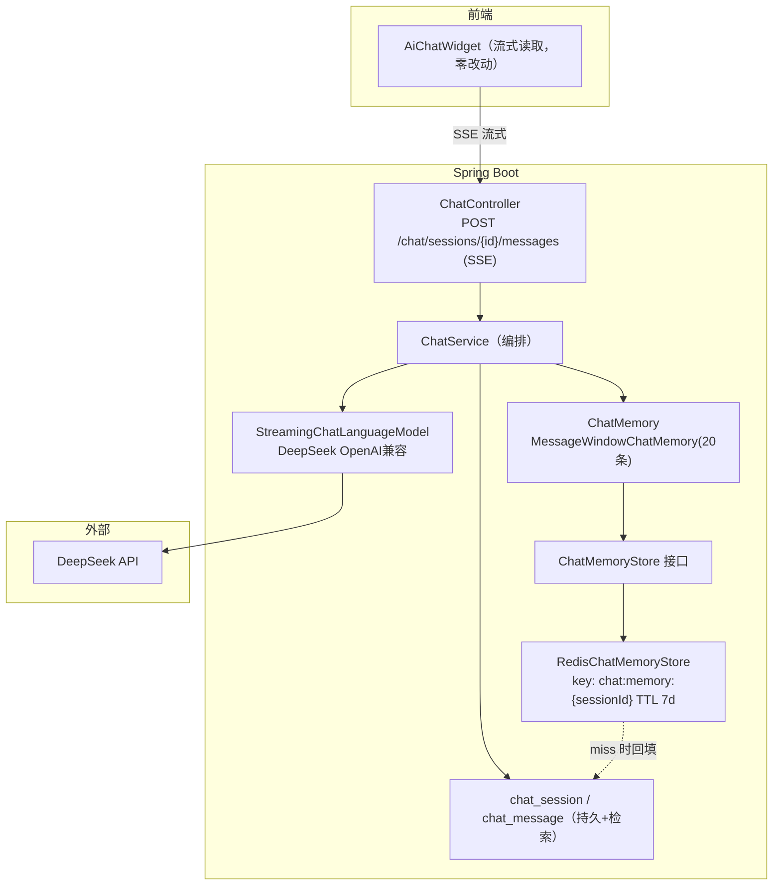

# AI 个性化学习资源分享平台 —— 扩展设计与亮点思路

> **文档定位**：在 V1 交付基础之上的演进设计。三条主线扩展（页面上下文问答、对话持久化、LangChain4j + Redis 记忆）对应学习者最痛的三个场景；后半部分给出产品与架构的储备思路和分期路线图。
>
> **读者**：课程评审、迭代决策者。所有"当前现状"描述均以仓库源码为准（`AiService` / `AiController` / `AiChatRequest` / `AiChatWidget.vue`）。

---

## 1. 演进总原则

先定规矩，再谈功能。V1 的代码是干净的（分层清晰、降级完备、测试资产齐全），扩展必须保住这些家底：

1. **增量演进，不推倒重来**：摘要、NL 搜索、推荐理由链路保持不动，只对"聊天"这一条链路动刀；
2. **降级传统承**：任何新扩展（Redis 记忆、向量检索、新模型）都必须沿袭 V1 的纪律——外部依赖缺席时核心链路不挂；
3. **数据先行**：新能力先想清楚落库结构（会话、消息、上下文快照、token 成本），再想界面；
4. **每步可独立交付、可回滚**：三个主线扩展之间弱耦合，任意一个上线失败不影响其他两个。

---

## 2. 当前实现留下的四个"口子"

| # | 现状（源码事实） | 局限 | 对应扩展 |
|---|---|---|---|
| 1 | `AiChatRequest` 只有 `message / route / pageTitle` 三个字段；system prompt 只注入页面标题和路由 | 用户在资源详情页看别人的笔记遇到专有名词（如"happens-before""边际效应"）时，助手**根本看不到页面正文**，只能泛泛而谈 | 扩展一 |
| 2 | 聊天消息只含 system + user 两条，无 session、无历史 | 单轮失忆，无法追问（"刚才说的第二点再展开"） | 扩展三 |
| 3 | 聊天接口无任何持久化；`/ai/chat/stream` 甚至是 permitAll 匿名可达 | 刷新即丢；学习平台最宝贵的"问过的问题"无法复习回顾，数据资产为零 | 扩展二 |
| 4 | 流式为完整应答后按 24 字/块推送（`splitForStreaming`）；AI 调用为手写 HttpClient | 首字延迟有上限；缺编排框架，记忆/工具/多模型都要手搓 | 扩展三 |

> 附一个小而确定的修复项：登出时 Token 黑名单**只写不读**（`AuthService` 写、`JwtAuthenticationFilter` 不校验），登出后 24h 内 token 仍有效。列入 P0 顺手修掉。

---

## 3. 扩展一：页面上下文感知问答

### 3.1 场景与目标

**场景**：用户在资源详情页读一份《Java 并发编程实战笔记》，遇到" happens-before "不理解。现在的助手看不到他在看什么，只能讲通用概念。**目标形态**：助手知道用户正在看的资源（标题、摘要、描述正文，以及用户划选的片段），回答针对这份资料，并标注依据来源。

### 3.2 前端设计

`AiChatWidget.vue` 已有 route/pageTitle 透传机制，扩展点极小：

- 组件新增 `pageContext` 注入（provide/inject 或 Pinia 轻量存储），由各页面按需填充；
- **资源详情页**（`ResourceDetail.vue`）：注入 `{ type: 'RESOURCE', resourceId, title, summary, excerpt }`，`excerpt` 取描述正文前 2000 字；
- **划词提问**（增强项）：监听 `selectionchange`，用户选中正文文字后聊天窗出现"解释这一段"入口，把选中文本作为 `selectedText` 一并上传——这是学习场景里最高频的动作，值得单独做；
- 无上下文的页面（首页等）不传，行为与现在完全一致（回归有保障）。

### 3.3 后端设计

`AiChatRequest` 增加可选字段：

```java
private String pageContextType;   // RESOURCE / SEARCH / NONE
private Long pageContextId;       // 资源ID（服务端可二次校验并富化上下文）
private String selectedText;      // 用户划选文本，≤500字
```

`AiService.streamChat` 组装 system prompt 时，把上下文放在**明确的分隔与指令边界**内：

```
[页面上下文开始]
资源标题：Java并发编程实战笔记
AI摘要：……
资料原文（截断）：……
用户划选：happens-before
[页面上下文结束]

规则：回答优先基于上方资料内容；资料中没有的信息，明确说明"资料中未提及"，
不要编造；回答末尾用【依据】标注引用了资料的哪部分。
```

两个关键纪律：

- **上下文截断**：正文超长时截断到模型窗口预算内（约 2000 字），保留与用户问题相关度高的段落（先用简单关键词重合度粗排）；
- **提示注入隔离**：资料原文和划选文本是不可信内容，用分隔符包裹 + 显式指令约束，防止笔记里藏"忽略以上指令"类文本操纵助手。

### 3.4 价值论证（投资人视角）

上下文问答把 AI 从"玩具问答"变成"伴学工具"：直接提升**停留时长与回访率**（学习者遇到不懂的就问，问完继续读），且为扩展二（对话持久化）提供了高质量的场景锚点——绑定在具体资源上的问答，正是复习时最想翻回去看的东西。

### 3.5 验收标准

- 详情页问"什么是 happens-before"，回答引用该资源描述中的相关内容并带【依据】标注；
- 不带上下文的页面（首页/搜索页）行为与 V1 完全一致（回归用例全绿）；
- 注入一段含"忽略以上指令"的笔记正文，助手不执行其中的指令。

---

## 4. 扩展二：对话持久化（MySQL 长时存储）

### 4.1 为什么必须做

这是学习平台，不是即时通讯。用户问过的问题——尤其是针对某份资料的追问——是**复习时最想翻回去的学习资产**。同时，对话数据是平台级资产：热门问题反哺资源采购与生产、优质问答可沉淀为公开内容（见 §7）。V1 的聊天是"一次性纸杯"，这个扩展把它变成"蓄水池"。

### 4.2 数据模型（新增 2 张表，与现有 14 张表并列）

```sql
-- 会话表
CREATE TABLE IF NOT EXISTS `chat_session` (
    `id` BIGINT NOT NULL AUTO_INCREMENT COMMENT '会话ID',
    `user_id` BIGINT NOT NULL COMMENT '所属用户',
    `title` VARCHAR(200) NOT NULL DEFAULT '' COMMENT '会话标题(首条消息自动生成)',
    `context_type` VARCHAR(20) NOT NULL DEFAULT 'GLOBAL' COMMENT '上下文类型: GLOBAL/RESOURCE',
    `context_id` BIGINT DEFAULT NULL COMMENT '关联资源ID(可空)',
    `message_count` INT NOT NULL DEFAULT 0 COMMENT '消息数(反维护)',
    `last_message_at` DATETIME DEFAULT NULL COMMENT '最后消息时间',
    `is_deleted` TINYINT NOT NULL DEFAULT 0 COMMENT '逻辑删除',
    `created_at` DATETIME NOT NULL DEFAULT CURRENT_TIMESTAMP,
    `updated_at` DATETIME NOT NULL DEFAULT CURRENT_TIMESTAMP ON UPDATE CURRENT_TIMESTAMP,
    PRIMARY KEY (`id`),
    KEY `idx_cs_user` (`user_id`),
    KEY `idx_cs_user_ctx` (`user_id`, `context_type`, `context_id`),
    KEY `idx_cs_last` (`last_message_at` DESC)
) ENGINE=InnoDB DEFAULT CHARSET=utf8mb4 COLLATE=utf8mb4_unicode_ci COMMENT='AI会话表';

-- 消息表
CREATE TABLE IF NOT EXISTS `chat_message` (
    `id` BIGINT NOT NULL AUTO_INCREMENT COMMENT '消息ID',
    `session_id` BIGINT NOT NULL COMMENT '所属会话',
    `role` VARCHAR(10) NOT NULL COMMENT '角色: user/assistant',
    `content` TEXT NOT NULL COMMENT '消息内容',
    `context_json` VARCHAR(1000) DEFAULT NULL COMMENT '提问时携带的页面上下文快照',
    `tokens_used` INT NOT NULL DEFAULT 0 COMMENT '消耗token(成本观测)',
    `latency_ms` INT NOT NULL DEFAULT 0 COMMENT '端到端延迟ms',
    `status` VARCHAR(20) NOT NULL DEFAULT 'OK' COMMENT '状态: OK/FAILED',
    `created_at` DATETIME NOT NULL DEFAULT CURRENT_TIMESTAMP,
    PRIMARY KEY (`id`),
    KEY `idx_cm_session` (`session_id`, `id`),
    KEY `idx_cm_created` (`created_at` DESC)
) ENGINE=InnoDB DEFAULT CHARSET=utf8mb4 COLLATE=utf8mb4_unicode_ci COMMENT='AI对话消息表';
```

设计说明：

- **不设物理外键**，与全库风格一致；`(session_id, id)` 复合索引支撑历史消息的顺序翻页；
- `context_json` 快照让每一次问答**可复现、可审计**（当时在看什么资料、问了什么）；
- `tokens_used / latency_ms` 为成本与性能观测预留——创业视角里，AI 功能的单位经济模型要从第一天开始记账。

### 4.3 API 设计

| 方法 | 路径 | 说明 |
|---|---|---|
| POST | `/api/v1/chat/sessions` | 创建会话（可带 contextType/contextId） |
| GET | `/api/v1/chat/sessions` | 我的会话列表（分页，按最后消息时间倒序） |
| GET | `/api/v1/chat/sessions/{id}/messages` | 会话历史（倒序分页） |
| POST | `/api/v1/chat/sessions/{id}/messages` | 在会话内继续提问（流式返回） |
| DELETE | `/api/v1/chat/sessions/{id}` | 软删除会话（仅本人） |
| GET | `/api/v1/chat/messages/search?keyword=` | 跨会话检索历史问答（复习入口） |
| POST | `/api/v1/chat/sessions/{id}/export` | 导出为 Markdown 笔记 |

产品决策：**登录用户的对话默认持久化；未登录游客仍可匿名提问**（保留 `permitAll` 的体验门槛优势），但在 UI 上明确提示"登录后可保存与复习对话记录"——把匿名流量转化为注册转化，而不是用墙挡住。

### 4.4 隐私与合规

- 会话与消息仅本人可读写（业务层按 `user_id` 校验，越权 403，与资源所有权校验同套路）；
- 删除即软删除 + 提供彻底删除入口；日志与上下文快照不记录密码、密钥等敏感信息（沿用 V1 纪律）；
- 用户可随时导出自己的全部对话数据（可携带权）。

### 4.5 验收标准

- 登录用户刷新页面/换设备后，历史会话与消息完整可见，分页稳定；
- 未登录用户可完成一次问答，界面出现"登录保存"提示；
- 删除会话后列表与检索均不可见；他人会话 ID 直接访问返回 403。

---

## 5. 扩展三：LangChain4j + Redis 上下文记忆

### 5.1 为什么引入 LangChain4j

V1 的 AI 调用是手写 HttpClient——能用，但记忆、窗口截断、流式、多模型这些诉求每加一个都要手搓一层。LangChain4j 是 Java 生态的 LLM 编排框架（与 Python 侧 LangChain 同源），与 Spring Boot 天然集成，且 DeepSeek 提供 OpenAI 兼容端点，LangChain4j 的 OpenAI 客户端改 `base-url` 即可对接，**迁移成本低、收益直接**：

- `ChatMemory` 抽象：多轮记忆成为框架能力而不是自己攒 List；
- `ChatMemoryStore` 接口：Redis 作为记忆存储是一等公民；
- `StreamingChatLanguageModel`：拿到真正的 token 级流式；
- 模型可插拔：切换供应商只改 `base-url` / `AI_MODEL` 配置（项目已由 Qwen 切至 DeepSeek 验证），本地模型同样只需一个 Bean。

> 说明：`pom.xml` 中已引入 `spring-ai-bom` 与 `spring-ai-starter-model-openai`（V1 实际调用由 `AiService` 自研实现，配置沿用 `spring.ai.openai.*` 命名空间）。演进时二选一：聊天链路迁往 LangChain4j（推荐，生态对记忆/流式支持更完整），Spring AI 依赖可择机移除；摘要/NL/推荐理由三条链路暂不动。

### 5.2 架构位置



### 5.3 记忆与截断设计

- **窗口记忆**：`MessageWindowChatMemory.withMaxMessages(20)`（约 10 轮问答）——超过窗口后最旧的消息被逐出。这是"截断"的第一层：简单、可预期、防上下文爆炸；
- **Redis 存储**：自定义 `ChatMemoryStore` 实现，消息 List 以 JSON 序列化存储，key 为 `chat:memory:{sessionId}`，TTL 7 天；Redis 不可用时静默降级为"无记忆单轮"（沿用 V1 降级纪律，不让缓存故障拖垮聊天）；
- **双写架构**：Redis 是热记忆（读写快），MySQL 是温存档（永久、可检索）。Redis miss（过期/被清）时从 MySQL 最近 N 条**回填重建**——用户侧无感；
- **进阶截断**（P2 储备）：`TokenWindowChatMemory` 按 token 预算截断；或对已滑出窗口的旧消息做**滚动摘要压缩**（Summarizing 思路），让长会话"忘细节不忘结论"——后者对"跨天继续讨论一个专题"的体验提升明显。

### 5.4 真实流式

用 `StreamingChatLanguageModel` 的 `onNext` 回调把 token 片段直接桥接到现有 `StreamingResponseBody` 的 `text/plain` 通道——**前端 AiChatWidget 的读取逻辑零改动**，首字延迟从"等完整应答"降到"等第一个 token"。

### 5.5 风险与权衡

| 风险 | 处理 |
|---|---|
| Redis 记忆丢失/被清 | MySQL 回填重建；最坏情况退化为单轮（有提示文案） |
| Token 成本随窗口增长 | 条数窗口封顶；`tokens_used` 入库观测；后续上 TokenWindow + 摘要压缩 |
| 多设备/多标签页一致性 | 记忆以服务端 session 为准，前端每次拉历史后渲染，不做本地长期缓存 |
| 页面上下文注入的提示注入 | 上下文分隔 + 指令边界（见 §3.3）；`context_json` 入库可审计 |
| 框架版本与 Java 17 兼容 | 选用与 Java 17 兼容的 1.x 稳定线，BOM 统一管版本；先在分支灰度，`spring-ai` 依赖择机移除 |

### 5.6 验收标准

- 同一会话第 3 轮能引用第 1 轮的信息（多轮一致性用例）；
- 超过 20 条窗口后，旧轮次被截断，请求 token 数不超预算；
- `FLUSHALL` 后继续提问，记忆从 MySQL 重建，用户无感；
- 流式首字延迟显著低于 V1（压测数据留档）。

---

## 6. 三大主线扩展的依赖与分期

```mermaid
gantt
    title 主线扩展演进路线
    dateFormat X
    axisFormat %d周
    section P0 核心场景
    登出黑名单修复      :a1, 0, 3d
    扩展一 页面上下文问答 :a2, after a1, 5d
    扩展二 对话持久化     :a3, after a1, 7d
    section P1 体验深化
    扩展三 LangChain4j+Redis记忆 :b1, after a2, 10d
    真实流式 SSE         :b2, after b1, 3d
    划词提问             :b3, after a2, 4d
    section P2 产品化
    RAG 检索增强问答     :c1, after b1, 14d
    AI 测验/闪卡生成     :c2, after b1, 14d
    学习路径规划         :c3, after c1, 10d
```



- **P0**：三个修复/扩展互不依赖，任一带病可单独回滚；扩展一先于扩展三落地（不等框架）；
- **P1**：LangChain4j 接管聊天链路时，扩展一/二已就绪，编排层直接复用上下文与持久化；
- **P2**：RAG 建立在"资源正文可被检索"之上，是扩展一的自然进阶。

---

## 7. 更多亮点思路（储备池）

按"产品差异化 × 工程可行性"排序，每个都标注了它与现有资产的关系——**这个项目的积累（推荐日志、搜索历史、互动数据、文件存储）让它们大多不是从零开始**。

1. **RAG 检索增强问答（扩展一的终极形态）**：解析资源文件（PDF/DOCX 文本抽取）与描述正文，向量化入库（Milvus / Redis Vector / pgvector 任选），问答时召回相关片段并**带引用回答**。从此"专有名词"问题的答案永远锚定在这份资料里， hallucination 有据可查。与扩展一的上下文注入是同一套 prompt 纪律，只是召回从"当前页"扩到"全库"。
2. **AI 生成测验与闪卡**：从资源内容生成选择题/填空题/问答卡，用户主动回忆（active recall）——这是"学习平台"区别于"资源站"的核心功能，也是留存利器。已有资源正文 + 摘要，提示词工程即可起步，后续接间隔重复算法（SM-2 简化版）。
3. **学习路径规划**：输入目标（"两周入门 Java 并发"），结合分类树与推荐系统排出资源顺序与每日节奏，进度可打卡。把"找资源"升级为"跟计划"。
4. **优质对话沉淀为公开笔记/QA 精选**：用户授权后把高质量问答整理为公开笔记，进入搜索与推荐池——UGC 内容飞轮，同时给运营提供了"用户在问什么"的选题矿（`chat_message` 本身就是需求数据库）。
5. **多模型路由 + 成本观测台**：按任务分流（摘要用小模型、推理用大模型、闲聊用最便宜的），`tokens_used/latency_ms` 已经在扩展二落库，成本看板是水到渠成的事——AI 功能从"烧钱部门"变成"可经营部门"。
6. **学习画像与周报**：基于已有的 `search_history`、`recommendation_log` 加上新的对话数据，生成"本周你关注 X、看了 Y、问过 Z"的学习周报（隐私同意前提下），把个人中心从"仓库"变成"学习仪表盘"。
7. **登出即时失效**：黑名单补读（过滤器加一次 Redis 查询，miss 放行）——半小时的修复，安全账本上补一块。
8. **先审后发配置化**：`resource.status` 状态机与审核链路已就绪，加一个平台级开关（新发布者先进 PENDING 队列，信誉高的直接 PUBLISHED），治理与体验兼得。
9. **内容安全增强**：评论 `status` 字段已预留审核位；接入敏感词 + AI 审核双通道，覆盖资源描述、评论与 AI 对话（防助手被诱导输出不当内容）。
10. **移动端/PWA 与微信生态**：PWA 先做（成本最低，手机浏览器可安装），后续按用户量决定是否小程序化。

---

## 8. 风险与权衡总表

| 扩展 | 最大风险 | 一句话权衡 |
|---|---|---|
| 上下文问答 | 提示注入 / 上下文超窗 | 用分隔与指令边界换能力，收益远大于风险面 |
| 对话持久化 | 存储成本与隐私敏感度 | 软删除 + 导出权 + 最小化快照，把信任做在前面 |
| LangChain4j 记忆 | 框架迁移期行为回归 | 摘要/NL/推荐链路不动，只换聊天链路，灰度可回滚 |
| RAG | 文件解析质量与检索召回率 | 先只索引 Markdown 描述与摘要，PDF 解析后置 |
| 测验生成 | AI 出错题误导学习 | 生成后附"参考答案与原文依据"，错题可反馈回流 |

---

## 9. 结语

V1 证明了这个团队能把一套主流栈**干净地**落地：链路通、降级全、文档齐。而真正让这个项目从"课程作业"走向"产品"的，是接下来这三步——**让 AI 看见用户正在看的内容（上下文）、记住用户问过的问题（持久化）、有章法地管理记忆与模型（LangChain4j）**。三步都不大，但每一步都踩在学习场景的真实痛点上；三步走完，"找资料 → 读资料 → 问问题 → 复习问题"的闭环才真正合上。后面的 RAG、测验、路径规划，都是在这个闭环上的自然延伸——这个项目的延展性，不在功能清单里，在它已经攒下的数据资产和没被敷衍的工程纪律里。

---

## 10. 扩展五：流式传输升级为标准 SSE（WebFlux Reactive 栈）

**背景**：扩展三的"真实流式"桥接在 `StreamingResponseBody` 的 `text/plain` 通道上——是真 token 级流式，但不是标准 SSE：错误文案混在正文里、多行内容无转义协议、没有事件语义，前端只能逐字节拼接。

**架构选型（混合式 Reactive）**：全量切 WebFlux 不现实——MyBatis（JDBC）、Servlet Security 过滤器、LangChain4j 阻塞回调都是阻塞生态。因此主栈保持 Spring MVC/Tomcat，仅流式聊天走 Reactive：pom 引入 `spring-boot-starter-webflux`，两个流式端点返回 **`Flux<ServerSentEvent<String>>`**（`text/event-stream`），Spring MVC 检测到 classpath 上的 Reactor 适配器后由 `ReactiveTypeHandler` 异步流式写出。

**改动**（2026-10）：

- 两个流式端点（游客 `POST /api/v1/ai/chat/stream`、会话内 `POST /api/v1/chat/sessions/{id}/messages`）改为返回 Reactor 流；
- 新增 `ChatStreamFactory` 统一封装：阻塞式聊天调用用 `Flux.create` 包裹、`subscribeOn(boundedElastic)` 移出请求线程；事件协议为 `event: message`（token 增量）、`event: done`（收尾）、`event: error`（基础设施失败，`onErrorResume` 统一转换）；客户端断开时 sink 被 cancel，后续 `next` 变为 no-op，服务侧落库记账不受影响；
- 会话端点在建连前**同步**校验所有权（`getOwnedSession`），403/404 走统一 JSON 异常处理返回，不再发生在流中；
- 前端仍用 `fetch + ReadableStream` 手动解帧（`EventSource` 不支持 POST 与 Authorization 头）：按空行分帧、解析 `event:`/`data:` 行，多行 data 还原；JSON 响应（业务异常）与 SSE 响应按 `content-type` 分流处理。

**收益**：错误有独立语义通道、多行内容协议级转义、响应式组合子（背压/超时/重试）为后续演进铺路；断线重连（`Last-Event-ID`）与多端同步有了协议基础；AI 链路本身（LangChain4j 底层回调、记忆窗口、落库记账）一行未动。

**权衡**：`boundedElastic` 默认线程数有限（10×CPU），每路流式对话独占一个线程直至结束——当前学习平台量级足够；若并发显著上涨，应先把 LangChain4j 换成非阻塞客户端（如 WebClient 直连 SSE）再把端点彻底 Reactive 化。
