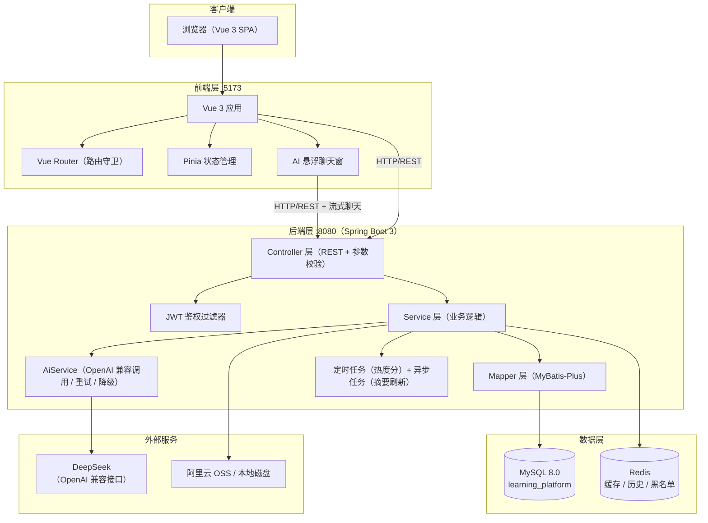
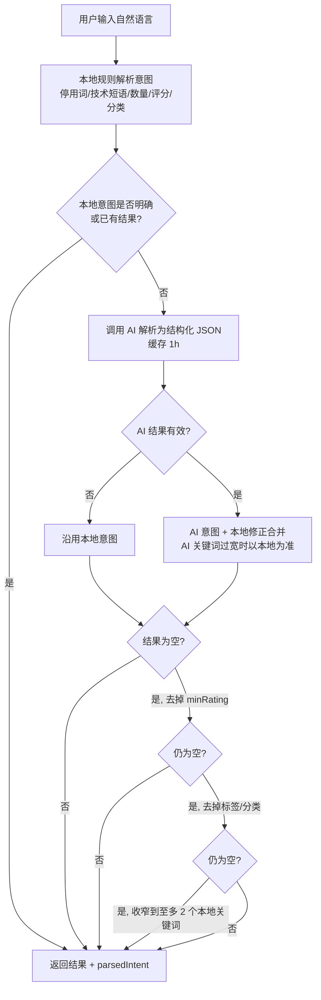
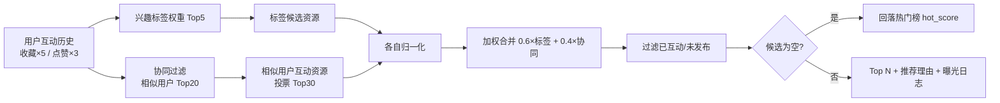

# AI 个性化学习资源分享平台 —— 架构设计与核心功能说明

> **文档定位**：项目总览与架构说明，面向课程评审与项目验收。回答四个问题——这个项目是什么、为什么做、怎么设计的、强在哪里。
>
> **配套文档**：`PRD.md`（产品需求摘要）、`需求分析文档.md`（需求分析）、`扩展设计与亮点思路.md`（扩展主线与路线图）、`openspec/`（规格化设计）、`docs/数据库实体关系图.html`（可交互 ER 图）。

---

## 1. 项目概述

**一句话定位**：一个面向大学生的学习资源共享社区——把散落在网盘、群聊和收藏夹里的学习资料，变成**可发现、可理解、可互动、可推荐**的学习资产，并用 AI 把"找资料、读资料、评资料"的成本降下来。

| 属性 | 内容 |
|---|---|
| 产品形态 | 前后端分离的 Web 平台（Vue 3 SPA + REST API） |
| 前端 | Vue 3 + TypeScript + Tailwind CSS + Pinia + Vue Router + Axios + marked |
| 后端 | Spring Boot 3.2.5（Java 17）+ MyBatis-Plus 3.5.5 + Spring Security + SpringDoc |
| 数据库 | MySQL 8.0（库名 `learning_platform`，utf8mb4，14 张业务表） |
| 缓存 | Redis（AI 应答缓存、推荐缓存、搜索历史/热榜、Token 黑名单） |
| AI 能力 | DeepSeek（OpenAI 兼容接口，默认 `deepseek-flash`，可由 `AI_MODEL` 切换） |
| 文件存储 | 阿里云 OSS（生产）/ 本地文件系统（开发回退），`storage.type` 一键切换 |
| 构建与运行 | Vite（前端，:5173）+ Maven（后端，:8080），Swagger 在线调试 |
| 种子数据 | `sql/seed.sql` 提供管理员 / 发布者 / 普通用户三类测试账号（凭据见 `README.md`） |

仓库结构：

```
├── backend/     Spring Boot 后端（config / controller / service / mapper / entity / dto / security / task）
├── frontend/    Vue 3 前端（views / components / api / store / router / types）
├── sql/         init.sql（建库建表，唯一权威源）+ seed.sql（统一测试数据）
├── docs/        交付文档（PRD、需求分析、架构与核心功能、扩展设计、ER 图）
├── openspec/    规格化设计（proposal / design / tasks）
└── prototypes/  需求原型 HTML
```

---

## 2. 为什么做这个项目

### 2.1 背景：一个真实的、未被解决好的问题

大学生的学习资料——课程笔记、实验报告、编程教程、复习提纲、公开课链接——长期分散在网盘、群聊、浏览器收藏夹和个人设备里。数量在涨，但**标题不统一、分类不存在、质量没反馈**，学习者很难快速判断一份资料是否适合当前课程和自己的水平。传统文件夹式管理只解决了"存放"，没有解决"发现、理解、评价和持续复用"。

落到产品层面，是五个具体痛点：

| 痛点 | 具体表现 |
|---|---|
| 资源难找 | 资料分散、命名随意、筛选维度少，检索基本靠缘分 |
| 检索门槛高 | 只支持精确关键词，无法表达"适合期末复习的 Java 并发资料"这类自然语言需求 |
| 预览成本高 | 长文和大文件没有摘要，要逐个打开才能判断内容是否相关 |
| 质量难判断 | 缺少评分、点赞、评论和审核机制，好坏资源混在一起 |
| 推荐不个性 | 只按热度排序，不利用用户自己的点赞、收藏、评分行为 |

### 2.2 产品定位与核心价值主张

构建一个学习资源共享社区，用 AI 做厚四件事：

1. **智能发现**——个性化推荐（混合算法 + AI 推荐理由），让每个用户看到适合自己的资源；
2. **自然交互**——自然语言搜索（NL2API），把"人话"翻译成结构化查询，降低检索门槛；
3. **高效预览**——AI 自动生成约 100 字摘要，秒判资源价值；
4. **社区共建**——点赞、收藏、评分、评论、发布者申请与审核，形成"贡献—反馈—治理"的闭环。

### 2.3 目标用户

| 角色 | 诉求 | 典型场景 |
|---|---|---|
| 普通学习者（USER） | 快速找到高质量资源，获得推荐和学习建议 | 课前预习、课后复习、考前冲刺 |
| 资源发布者（PUBLISHER） | 便捷发布资源，获得浏览、点赞、收藏和评论反馈 | 整理笔记后上传、分享学习心得 |
| 管理员（ADMIN） | 审核资源、管理用户、维护分类标签体系 | 内容治理、角色审批、平台运营 |

### 2.4 做这个项目的另一层意义

对课程实践而言，这不是一个"增删改查"作业：它把 **Vue 3 + Spring Boot + MySQL + Redis + JWT + REST + 文件存储 + AI 接入**的完整工程链路装进一个真实产品里，并且认真处理了工程上最麻烦的部分——外部依赖（AI、Redis、OSS）随时可能不可用时，系统怎么活。这个问题的答案（见 §6.1 降级设计）是本项目最有分量的部分。

---

## 3. 总体架构设计

### 3.1 系统架构图



### 3.2 分层职责

| 层 | 职责 | 关键实现 |
|---|---|---|
| 表现层 | 页面渲染、路由守卫、交互状态、Markdown 渲染、流式聊天读取 | Vue 3 组合式 API + Pinia；`AiChatWidget` 全局悬浮可拖动 |
| 接口层 | REST 端点、参数校验、统一响应 | `Result`/`PageResult` 统一响应体；Jakarta Validation；SpringDoc |
| 业务层 | 认证、资源、搜索、推荐、互动、AI 编排 | 各 Service；`@Async` 摘要刷新；`@Scheduled` 热度分 |
| 数据层 | 持久化与条件查询 | MyBatis-Plus `QueryWrapper` + 分页插件 |
| 缓存层 | AI 应答、推荐结果、搜索历史/热榜、Token 黑名单 | RedisTemplate，**全部读写包 try-catch，失败即降级** |
| 横切关注点 | 认证鉴权、异常转换、CORS、跨域 | `JwtAuthenticationFilter`、`GlobalExceptionHandler`、`CorsConfig` |

### 3.3 关键设计决策

1. **无状态认证**：JWT（HS256，access 24h + refresh 7d），服务端不存会话，角色权限从 Token + 数据库实时角色合并得出。
2. **AI 绝不阻塞主流程**：资源发布时同步写本地摘要保证接口秒回，AI 摘要走 `@Async` 异步刷新；AI 不可用时本地摘要即为最终摘要。
3. **逻辑外键而非物理外键**：14 张表不声明任何 `FOREIGN KEY`，关系约束放在业务层——换取写入灵活度和分库分表空间，代价由唯一索引和业务校验兜住。
4. **计数反规范化**：资源的点赞/收藏/评论/评分计数直接维护在 `resource` 行上（定时任务算热度分），避免列表页实时聚合。
5. **AI 只吐结构、不碰 SQL**：自然语言搜索让模型返回结构化 JSON 意图，查询由后端按白名单参数构造，从根上堵住注入面。

---

## 4. 核心功能设计

### 4.1 用户认证与权限（RBAC）

- **认证链路**：注册（用户名/邮箱/密码，BCrypt 存储）→ 登录签发 access + refresh token → `POST /auth/refresh` 续期 → 登出。
- **密钥强校验**：`JWT_SECRET` 缺失、少于 32 字节、或等于历史上泄漏过的默认值时，**应用启动直接失败**（`JwtUtil#checkSecret`）——宁可起不来，不带病运行。
- **三层权限防护**：
  1. URL 级白名单（SecurityConfig）：登录注册、资源/分类/标签的 GET、搜索、Swagger、静态文件公开；`/admin/**` 必须 ADMIN；资源写操作必须 PUBLISHER/ADMIN；其余全部需认证；
  2. 方法级角色注解（`@EnableMethodSecurity`）；
  3. 业务层所有权校验：改/删资源时校验 `publisher_id` 与当前用户一致，否则 403。
- **角色热更新**：JWT 里带角色，但每次请求会与数据库实时角色比对；管理员在后台修改角色后，用户**下一个请求的响应头**会带上新签发的 `X-New-Token` / `X-New-Refresh-Token`，前端无感续签，不必强制重新登录。
- **发布者申请流**：USER 提交申请（`publisher_application`，PENDING/APPROVED/REJECTED）→ 管理员审批 → 通过后角色升级为 PUBLISHER。申请已处理的重复审批会被拒绝。
- **登出**：Token 写入 Redis 黑名单（TTL 24h）。已知边界：当前鉴权过滤器未读取黑名单，登出主要依赖 access token 的 24h 自然过期（见 §6.3）。

### 4.2 资源管理

- **两种资源形态**：文件上传（PDF/DOCX/PPTX/MP4/ZIP，单文件 ≤500MB）或外部链接；描述支持 Markdown。
- **状态机**：`DRAFT`（草稿）/ `PENDING`（待审核）/ `PUBLISHED`（已发布）/ `REJECTED`（已驳回）。草稿直接存；正式提交直接上架；管理后台对待审核资源执行通过/驳回，审核能力完整保留（后续可配置化为"先审后发"）。
- **分类与标签**：两级分类树；标签随用随建（不存在则创建，`usage_count` 累计），热门标签按使用次数排序。
- **摘要双轨**：发布时同步生成本地摘要（去 Markdown 语法、标题 + 描述前 80 字、≤110 字）保证详情页立即可读；随后 `@Async` 尝试 AI 摘要（约 100 字）并回写。
- **上传安全**：随机 UUID 存储名 + 日期分目录、扩展名白名单、大小限制、OSS 私有桶/本地回退可切换。

### 4.3 搜索：关键词 + 自然语言双通道

**关键词搜索**（`GET /api/v1/search`）：

- 标题/描述 LIKE 匹配；复合词自动拆分（"Java并发编程" → `Java`/`并发`/`编程`，保留原词），解决中文复合词搜不到的问题；
- 注：`resource` 表已建 ngram 全文索引（`ft_resource_title_desc`），但当前检索走 LIKE 路径（配复合词拆分）；切换 FULLTEXT 检索是已预留的演进项；
- 分类筛选自动展开全部后代分类；多标签按 AND 语义过滤（`HAVING COUNT(DISTINCT tag) = N`）；
- 排序：relevance（默认按热度）/ latest / rating / hot；分页 + 空结果前端引导清除筛选。

**自然语言搜索**（`POST /api/v1/search/nl`）——本项目工程含量最高的一条链路，采取"**本地规则优先，AI 增强，逐级放宽**"的稳健策略：



- 意图字段：`keywords / category / tags / sortBy / limit / minRating`，**AI 只返回 JSON 意图，永不直接生成 SQL**；
- 放宽过程在响应里标记 `relaxed: true`，用户知道结果是被放宽过的，不是被忽悠的；
- 搜索历史（Redis List，每人 20 条去重，30 天）与热门搜索（全站 List 截断 100，7 天）。

### 4.4 AI 能力（摘要 / NL 解析 / 推荐理由 / 流式聊天）

统一经由 `AiService`，通过 **OpenAI 兼容协议**对接 DeepSeek（JDK HttpClient 实现，连接 5s / 读取 20s / 聊天 120s 超时，聊天默认 2 次重试）：

| 能力 | 提示词策略 | 缓存 | 失败行为 |
|---|---|---|---|
| AI 摘要 | 标题 + 描述（截断 2000 字）→ 约 100 字 | 内容哈希缓存 24h | 本地摘要兜底，不阻塞发布 |
| NL 意图解析 | 输出结构化 JSON（含 few-shot 约束） | 1h | 本地规则解析 + 逐级放宽 |
| 推荐理由 | 用户兴趣 + 资源信息 → ≤50 字 | 6h | 本地可解释理由（"匹配你关注的 X、评分 4.8 分、近期热度较高"） |
| 流式聊天 | system prompt 携带当前页面标题/路由 | 无 | 明确错误透传（未配置/403 鉴权失败/重试后失败），不伪装成功 |

**流式聊天**：`POST /api/v1/ai/chat/stream` 返回 `text/plain` 分块响应，前端 `fetch + ReadableStream` 逐段渲染；后端按 24 字/块推送完整应答（模拟流式观感），带重试与错误文案。当前为单轮对话（system + user 两条消息），**不携带页面正文、不记忆多轮上下文**——这正是《扩展设计与亮点思路》要解决的主线问题。

### 4.5 个性化推荐（混合推荐）



- 冷启动（无任何互动）直接回落热门榜；推荐结果缓存 30 分钟；每条推荐带 `algorithm`（HYBRID/HOT）、`score` 和 `recommendReason`；
- 曝光记录落 `recommendation_log`，为后续推荐效果评估留了数据；
- 推荐理由只对前 5 条调 AI，其余用本地可解释理由——**理由可解释、成本可控**。

### 4.6 社区互动

- **点赞**：`like_record` 唯一约束 `(user_id, target_id, target_type)`，多态支持资源与评论，幂等切换；计数增量更新（`max(0, current±1)`），不为负；
- **收藏**：唯一约束幂等切换，切换后按资源重算收藏数；
- **评分**：每用户每资源一条记录，重复提交覆盖；均分用 `BigDecimal` 两位精度 HALF_UP 重算；
- **评论**：一级评论 + 回复两级结构（`parent_id`），评论可点赞，`status` 字段预留审核扩展位；
- **热度分**：定时任务每小时刷新，`hot_score = 浏览 + 点赞×3 + 收藏×5 + 评分人数×2 + 平均分×10`，驱动默认排序与热门榜。

### 4.7 管理后台

用户管理（分页 + 角色/状态修改）、资源审核（待审核队列 + 通过/驳回）、发布者申请审批、分类/标签 CRUD、平台统计仪表盘（已发布/待审核资源数、待处理申请数、今日新增用户）。全部接口仅 ADMIN 可达。

### 4.8 文件存储与缓存降级

- **存储双轨**：`storage.type=local` 走本地磁盘（`/files/**` 静态映射），`=oss` 走阿里云 OSS，业务代码零改动；
- **Redis 全链路降级**：AI 三类缓存、推荐缓存、搜索历史/热榜、Token 黑名单——每一次 Redis 读写都包了 try-catch，失败仅记 WARN 并继续走数据库/本地逻辑。**断开 Redis，核心浏览、搜索、互动链路照常工作**；
- **AI 全链路降级**：无 Key → 本地摘要 + 明确提示；超时/429/403 → 兜底理由或错误透传。

---

## 5. 数据模型

`sql/init.sql` 为唯一权威源，共 **14 张业务表**（引用数据模型时以 `init.sql` 与本文为准）：

| 主线 | 表 | 要点 |
|---|---|---|
| 用户 | `user` | username/email 唯一；role 三角色；BCrypt；逻辑删除 |
| 内容 | `category` / `tag` / `resource` / `resource_tag` / `resource_file` | 分类树 parent_id；标签 usage_count；资源四态 + ai_summary + hot_score + 反计数；`(resource_id, tag_id)` 唯一；ngram 全文索引 |
| 互动 | `comment` / `like_record` / `favorite` / `rating` | like_record 多态唯一约束；favorite/rating 每用户每资源唯一 |
| 搜索与推荐 | `search_history` / `user_interest` / `recommendation_log` | 搜索历史（KEYWORD/NL）；兴趣权重；推荐曝光日志（算法 + 理由） |
| 治理 | `publisher_application` | 发布者申请三态流转 |

设计要点：**不设物理外键**（关系是逻辑外键）；**用唯一约束保证幂等**（点赞/收藏/评分）；**用日志表支撑可解释性**（推荐理由有据可查）；互动表全部 `created_at` 倒序索引支撑时间线查询。可视化交付物：`docs/数据库实体关系图.html`（单文件、无外部依赖、可交互高亮）。

---

## 6. 项目特点与优势亮点

### 6.1 工程亮点（架构视角）

1. **全链路降级设计——本项目最硬的亮点**。AI、Redis、OSS 三个外部依赖全部"可缺席"：无 AI Key 能演示完整发布/搜索/互动；断 Redis 核心链路不挂；OSS 换本地存储不改代码。这不是运气，是每一处调用点都显式处理了失败。
2. **三层权限防护 + 角色热更新**：URL 白名单 → 方法级角色 → 业务层所有权；角色变更后响应头自动续签，权限生效不等登录态轮换。
3. **幂等交互模型**：点赞/收藏/评分全部由数据库唯一约束兜底，重复点击、重复提交不会产生脏数据。
4. **缓存分级 TTL**：摘要 24h / NL 1h / 推荐理由 6h / 推荐结果 30min / 搜索历史 30d——按"变化成本"而不是一刀切设过期。
5. **密钥与配置边界**：JWT_SECRET 启动强校验（含泄漏默认值黑名单）、数据库/AI/OSS 密钥全部环境变量注入、`application-local.yml` 进 gitignore。
6. **文档—代码—测试同仓**：需求分析 → PRD → 架构设计 → 原型 → 源码 → 后端测试（62 项）→ ER 图，交付链完整且互相引用。

### 6.2 产品亮点（产品视角）

1. **AI 长在真实动线上，不是聊天玩具**：摘要解决"预览成本"，NL 搜索解决"表达门槛"，推荐理由解决"为什么推给我"——每个 AI 能力都对应一个具体痛点。
2. **推荐可解释**：每条推荐带理由（AI 生成或本地可解释），曝光落日志——推荐系统从"黑盒吐列表"变成"可审计的决策"。
3. **搜索的稳健策略**：本地规则优先保底速，AI 增强提上限，空结果逐级放宽并显式告知——比"AI 一把梭"更符合真实网络环境。
4. **社区闭环**：发布者申请 → 审批 → 发布 → 互动反馈 → 热度分 → 反哺推荐，贡献者获得可见的正反馈。

### 6.3 当前边界（诚实清单）

不掩饰的已知缺口，按严重度排序——它们同时也是下一篇《扩展设计与亮点思路》的输入：

| # | 边界 | 影响 |
|---|---|---|
| 1 | AI 聊天只透传页面标题/路由，**不带页面正文**，且为单轮无记忆 | 看笔记遇到专有名词时，助手答不到点子上 |
| 2 | 对话**不持久化**，刷新即丢 | 学习平台最宝贵的"问过的问题"无法复习回顾 |
| 3 | 流式聊天为完整应答后分块推送（模拟流式） | 首字延迟体验有上限 |
| 4 | 登出黑名单只写不读 | 登出后 token 在 24h 内仍有效（依赖自然过期） |
| 5 | 资源发布直接上架，审核队列未前置 | 内容风险前置依赖管理员抽查 |
| 6 | 后端测试覆盖核心服务（62 项全通过），前端以构建期类型检查 + 人工/浏览器复测为主 | 前端自动化测试尚未建立 |

---

## 7. 非功能需求与安全设计

- **性能**：普通列表/详情 P95 < 500ms（不含 AI）；Hikari 连接池 20/5；分页 + 索引 + 缓存热点数据；AI 接口分级超时。
- **安全**：BCrypt 密码哈希；JWT 无状态 + 双 token；XSS 防护（Markdown 渲染限制、AI 输出按不可信文本处理、外链协议限制）；文件上传白名单 + 随机名 + 大小限制；生产强制环境变量注入密钥、HTTPS。
- **可观测**：业务异常统一转换为标准响应结构；AI 与 Redis 调用记录耗时与失败原因；日志不输出密码、密钥和完整敏感内容。
- **可用性**：响应式适配；统一 Toast / 模态弹窗；路由守卫（登录 / 发布者 / 管理员）。

---

## 8. 测试与交付

| 资产 | 位置 | 状态 |
|---|---|---|
| 后端单元/集成测试 | `backend/src/test/`（62 项） | ✅ 全部通过（`mvn test`） |
| 测试用例 | `tests/test_cases.md`（git 历史） | 已编写（认证权限 / 资源链路 / 搜索推荐 / 互动 / 降级安全 / 管理后台） |
| API/UI 自动化脚本 | `tests/`（git 历史） | 早期版本，已随项目清理移除，需要时从 git 历史恢复 |

交付边界（与需求分析一致）：V1 交付 14 张核心表 + 种子数据、前后端源码、原型与全套文档；中文全文分词、内容安全扫描、登录限流、生产级观测列为后续迭代（见《扩展设计与亮点思路》）。

---

## 9. 小结

这个项目的价值不在"又做了一个资源站"，而在它用一套**主流、朴素、可复现**的技术栈（Vue 3 + Spring Boot + MySQL + Redis），把一个真实学习场景的问题链——**发现（搜索/推荐）→ 理解（摘要/问答）→ 判断（评分/评论）→ 沉淀（收藏/历史）**——完整跑通，并且在工程上认真回答了"外部依赖随时挂掉系统怎么活"。AI 能力全部嵌入动线、全部带降级、全部可解释；数据模型为推荐与治理预留了日志位。它的下一幕（页面上下文问答、对话持久化、LangChain4j 记忆编排）已经在《扩展设计与亮点思路》中展开。
